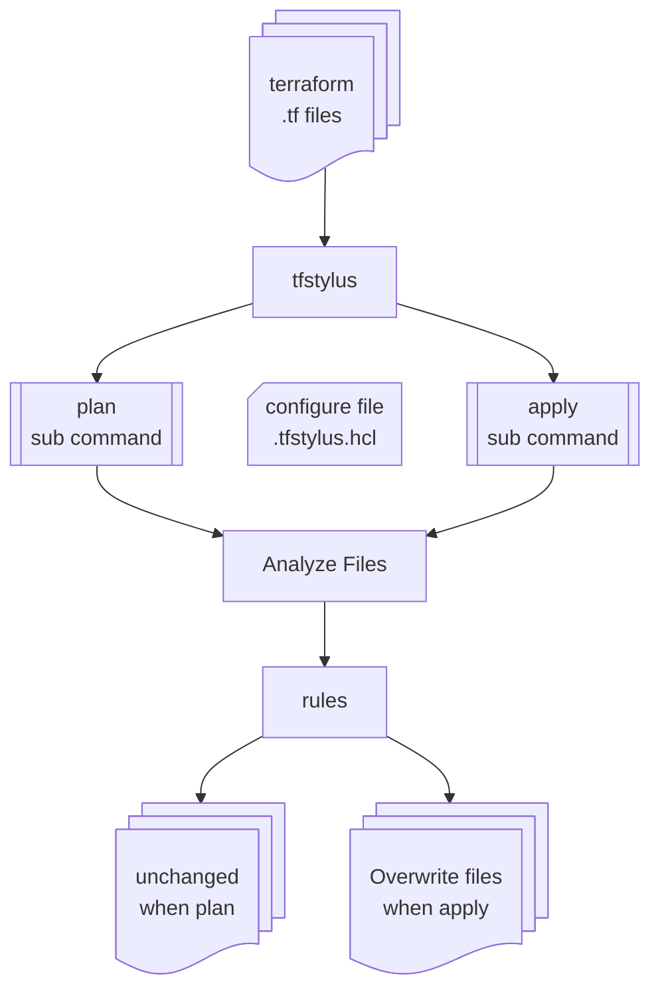

# tfstylus

[Ask DeepWiki](https://deepwiki.com/officel/tfstylus) |
[Gitingest](https://gitingest.com/officel/tfstylus) |
[OpenSSF Scorecard](https://securityscorecards.dev/viewer/?uri=github.com/officel/tfstylus)

Terraform コードのスタイルを整える Go 製 CLI です。

## 概要



- `plan` で差分を確認し、`apply` で適用できます
- `apply` は `plan` の保存結果ではなく、その時点のファイルと設定から変更を再計算します
- `terraform` と違って `state` はないということです
- 変更後は必要に応じて `terraform fmt` や `terraform validate` を実行してください

## demo

たとえば次のような `variable.tf` があるとき

```hcl:variable.tf
variable "test" {
  default     = "test001"
  type        = "string"
  description = "テスト"
}
```

`tfstylus plan` で差分を確認

```patch
variable.tf: rename to variables.tf [file-name/variables] variable.tf contains a variable block and variables.tf does not exist
variable.tf:1:1: variable_order: variable elements should be ordered description, deprecated, sensitive, nullable,ephemeral, const, type, default, validation
diff --git a/variable.tf b/variables.tf
similarity index 66%
rename from variable.tf
rename to variables.tf
--- a/variable.tf
+++ b/variables.tf
@@ -1,6 +1,6 @@
 variable "test" {
+  description = "テスト"
+  type        = "string"
   default     = "test001"
-  type        = "string"
-  description = "テスト"
 }
```

`tfstylus apply` すると `variable`**s**`.tf` に rename して並べ替えをします

```hcl:variables.tf
variable "test" {
  description = "テスト"
  type        = "string"
  default     = "test001"
}
```

歴史のある組織で整列されていないコードが大量にある時などに便利です

## usage

```sh
# homebrew でインストール（現在はリリースから直接ダウンロードするか、brew しか用意できていません）
$ brew tap officel/tap
$ brew install tfstylus

# バージョン
$ tfstylus version

# デフォルトでは何もしません
$ tfstylus
Version: dev
Usage: tfstylus <command> [flags]

Commands:
  init               Create a configuration with all rules disabled
  plan               Show planned changes and a unified diff without modifying files
  apply              Apply style fixes
  version            Show version

Flags:
  -c, --config PATH  Configuration file path (init: output path)
  --chdir DIR        Set the target directory (default: current directory)
  -r, --recursive    Search directories recursively (plan/apply)
  -d, --diff         Show a unified diff after applying changes (apply only)
  -v, --verbose...  Use verbose output (-v: info, -vv: debug, -vvv: trace)
  -h, --help         Show this help

# 設定ファイルを生成する
$ tfstylus init
Created configuration: .tfstylus.hcl

# 設定ファイルはデフォルトですべての機能をオフになることを確認します（差分はでません）
$ tfstylus plan --recursive
No changes.

# 設定ファイルを削除するか必要な設定をオンにして調整してください（差分を見ながら調整できます）
$ tfstylus plan --recursive

# apply で差分を適用します（戻せないので git 等でがんばって）
$ tfstylus apply
```

- `plan` はファイルを変更せず、変更箇所・理由と unified diff を表示します。正常・変更なしなら `No changes.` を表示します
- `plan` の終了コードは変更なし `0`、変更予定あり `1`、エラー・安全スキップ `2` です
- `apply` は確認待ちなしで、現在の入力と設定から再計算・検証して適用します。保存済み plan の適用ではありません。成功 `0`、エラー `2` です
- `apply -d/--diff` は適用成功後の差分を表示します。通常の `apply` と、変更がない場合は無出力です
- `-v` / `--verbose` は stderr に詳細ログを追加します。`-v` は info、`-vv` は debug、`-vvv` 以上は trace です。反復・混在指定も加算し、コマンドの前後で指定できます。通常出力と diff は変わりません。
- 今のところインストールは前述のとおり brew を使用するかリリースからダウンロードしてください
- [ドキュメント](./docs/README.md) は順次整理中です（機能ごとにAIにがんばってもらったのでなかなか）
- [開発者向け](./docs/dev.md) も少しずつ書き進めています
- 日本人なので日本語で書いています。海外で活用されるツールになるとも思えませんし、翻訳の予定はありません
- [DeepWiki](https://deepwiki.com/officel/tfstylus) を見ていただくほうが手っ取り早いかもしれません
